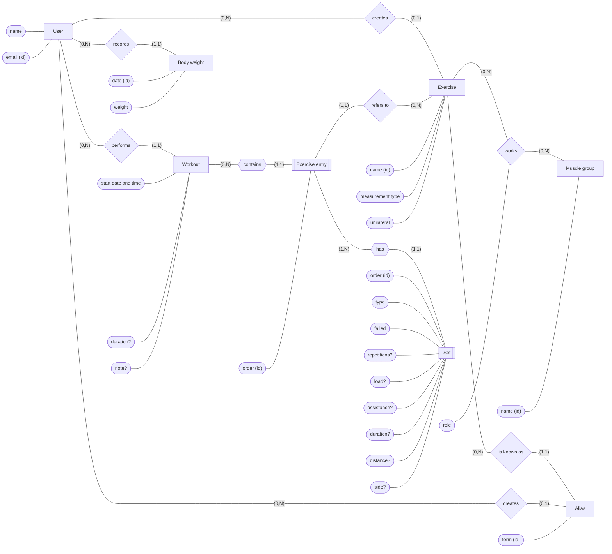

# 02 — Conceptual model

Second step of the design process. Derived from the [miniworld](01-miniworld.md), it describes **the world**, not the database:
there are no tables, columns or types here — those are decided in the logical model.

## Entities and attributes

| Entity | Attributes | Identifier |
|---|---|---|
| **User** | name, email | email |
| **Exercise** | name, measurement type, unilateral | name + owner (system or user) |
| **Muscle group** | name | name |
| **Alias** | term | term + owner (system or user) |
| **Workout** | start date and time, duration *optional*, note *optional* | no natural one — artificial in the logical model |
| **Exercise entry** *weak* | order | workout + order |
| **Set** *weak* | order, type, failed, repetitions *optional*, load *optional*, assistance *optional*, duration *optional*, distance *optional*, side *optional* | exercise entry + order |
| **Body weight** | date, weight | user + date |

User, exercise, alias, workout and body weight also record when they were created and last updated. Entries
and sets are part of their workout: a change to them counts as a change to the workout.

- **Measurement type** is a simple attribute with four values (weight and reps, bodyweight, time, distance and
  time). It does not specialize Exercise into subtypes: every exercise has the same attributes, and the type only
  decides which set attributes apply.
- **Muscle group is an entity, not an attribute,** because an exercise works several of them and each link has
  its own attribute (the role). Its instances are a fixed catalog, created with the system.
- **Alias is an entity, not a multivalued attribute of Exercise,** because each alias has its own owner: a user
  can add an alias to a system exercise, and that alias is visible only to them.
- **Exercise entry and set are weak entities:** they only exist inside their workout, and are identified by
  their order within it.
- **Load and assistance** are both in kg. For weight-and-reps exercises, load is the weight lifted; for
  bodyweight exercises, load is the **added** weight and assistance is the weight **removed** (assisted
  machine, band). Whether they become one signed value or two columns is decided in the logical model.
- **Derived values are not attributes:** volume, estimated one-rep max, personal records, pace and the real
  load of bodyweight exercises all come from queries.

## Relationships and cardinalities

`(min, max)` notation: the minimum tells whether participation is optional (0) or mandatory (1); the maximum, whether it is at most one (1) or many (N).

| Relationship | Reading | Type |
|---|---|---|
| User **creates** Exercise | A user creates (0,N) exercises. An exercise is created by (0,1) user; with none, it is a system exercise. | 1:N |
| Exercise **works** Muscle group, with attribute **role** (primary, secondary) | An exercise works (0,N) muscle groups. A muscle group is worked by (0,N) exercises. | N:N |
| Exercise **is known as** Alias | An exercise is known as (0,N) aliases. An alias refers to (1,1) exercise. | 1:N |
| User **creates** Alias | A user creates (0,N) aliases. An alias is created by (0,1) user; with none, it is a system alias. | 1:N |
| User **performs** Workout | A user performs (0,N) workouts. A workout is performed by (1,1) user. | 1:N |
| Workout **contains** Exercise entry | A workout contains (0,N) entries. An entry belongs to (1,1) workout. | 1:N, identifying |
| Exercise entry **refers to** Exercise | An entry refers to (1,1) exercise. An exercise is referred to by (0,N) entries. | 1:N |
| Exercise entry **has** Set | An entry has (1,N) sets. A set belongs to (1,1) entry. | 1:N, identifying |
| User **records** Body weight | A user records (0,N) body weights. A body weight is recorded by (1,1) user. | 1:N |

- **A workout may have no entries** for a moment, so it can be opened before the first exercise is added
  (logging set by set). An entry, on the other hand, only exists with at least one set.

## ER diagram

Peter Chen notation: rectangles are entities (double for weak entities, drawn here as `[[ ]]`), diamonds are
relationships, ellipses are attributes (identifiers are underlined in theory; marked with `(id)` here).

## Constraints the diagram cannot express

Must be enforced in the physical model or in the API:

1. **Set attributes follow the measurement type:**
   - weight and reps → repetitions and load;
   - bodyweight → repetitions, and optionally load (added) or assistance, never both;
   - time → duration;
   - distance and time → distance and duration.

   Attributes that do not apply stay empty. Numeric values cannot be negative.
2. **Side only on unilateral exercises:** a set may record a side only if its entry's exercise is unilateral.
3. **Visible exercises only:** an entry refers to a system exercise or to one created by the workout's owner.
   Likewise, a user's alias refers to a system exercise or to one of their own; a system alias refers only to
   a system exercise.
4. **One term, one exercise, by scope and precedence:** within one scope — the system, or a single user — a
   name or alias leads to at most one exercise. When the same term exists in both scopes, the user's wins.
   A search therefore always has at most one answer, and a new system alias never clashes with a term a user
   already has. A user's exercise cannot take the name of a system exercise, so lists never show two
   exercises with the same name. The comparison ignores case and accents; how it is normalized is decided in
   the physical model.
5. **System exercises list their muscle groups:** a system exercise works at least one muscle group, with at
   least one in the primary role, except distance-and-time exercises (cardio), which have none. For user
   exercises it is optional.
6. **Order is relative:** entry order is unique within its workout, and set order is unique within its entry.
7. **One body weight per day:** a user records at most one body weight per date.
8. **Deletes:**
   - deleting a workout deletes its entries and sets;
   - a user's exercise cannot be deleted while any entry refers to it;
   - deleting an exercise deletes its aliases and its links to muscle groups;
   - system exercises, system aliases and muscle groups are never deleted by users.
